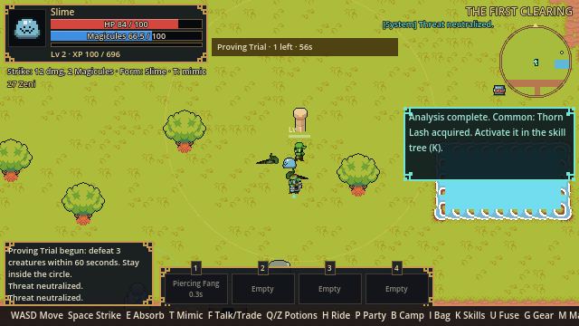
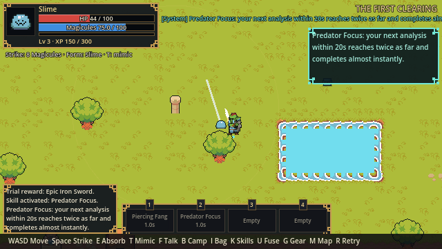
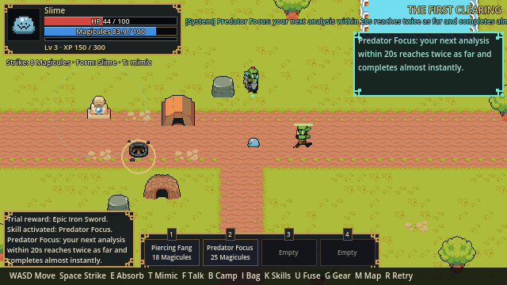
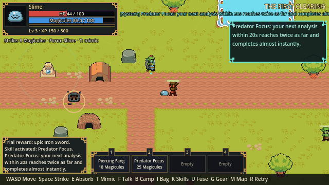
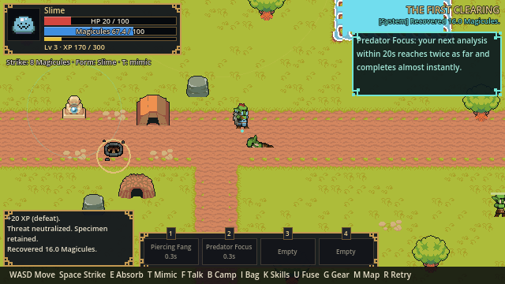
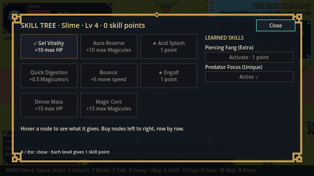
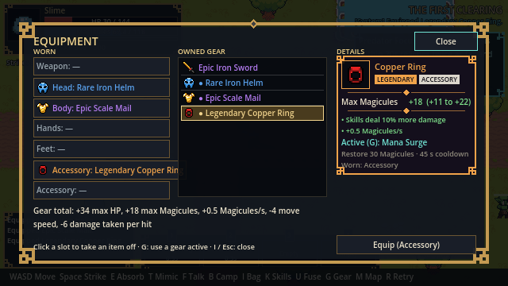
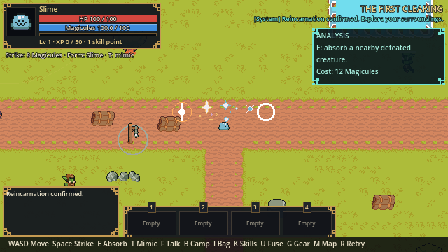

# Visual playtest — full first slice

## 0. Title menu

*Title screen: storm backdrop, logo, ornamented menu with the slime marker (New Game, Continue, Load Game, Join a Friend, Settings, Credits, Quit)* (640x360)

*Credits: every art pack, including the required Kyrise attribution* (640x360)

*New World: name and seed (numbers or any text, empty = random)* (640x360)

Automated, visible run on Windows. Viewport (640.0, 360.0), window (1280, 720). Movement, combat, absorb, skills and menus use the real input actions; menu buttons are pressed programmatically.

## 1. Spawn
- [x] Base resolution is 640x360

*Spawn: HUD, controls bar, hotbar and event log at 640x360* (640x360)

## 2. First fight

*Fighting: strike arc and enemy health bar* (640x360)

- [x] Defeated the first Forest Gnasher with real strikes

*Gnasher defeated; Magicule drop beside the corpse* (640x360)

## 3. Absorb and analyze

*Absorbing gnasher_1: analysis channel and progress bar* (640x360)

- [x] Absorbed the corpse
- [x] Rending Bite learned, waiting for activation

*Skill tree (K): the Slime tree on the left, learned skills on the right; Rending Bite activated with the level-1 point* (640x360)

- [x] Activated Rending Bite in the skill tree (K)
- [x] Activated Rending Bite sits in hotbar slot 1
- [x] Defeat dropped a Magicule pickup (collected on the spot when standing next to it)

*Hotbar shows Rending Bite with cost* (640x360)

- [x] I opens the bag and pauses offline play

*Dimensional storage with Gnasher Essence* (640x360)

- [x] I closes the bag
## 4. Recruit and name the goblin
- [x] Walked west to the goblin
- [x] F opens the ally dialog

*Ally dialog before recruitment* (640x360)

- [x] Recruited the goblin

*Naming dialog: cost preview and name field* (640x360)

- [x] Named the ally Aster; evolved to Hobgoblin

*Namer asleep below 25% Magicules; recovery timer; evolved Hobgoblin* (640x360)

- [x] Recovered from naming exhaustion
## 5. Found the camp and put the ally to work
- [x] Walked to the camp flag

*Camp menu before founding* (640x360)

- [x] Founded the camp
- [x] Assigned the ally to gather

*Ally walking between near deposits* (640x360)

- [x] Ally gathered all near deposits (16 wood, 8 stone)
- [x] Assigned the ally to build
- [x] Ally built the Goblin Hut

*Goblin Hut built; camp level 2* (640x360)

## 6. Explore for outlying materials
- [x] Walked east to the outlying wood

*Outlying wood near the second Gnasher* (640x360)

*Fighting: strike arc and enemy health bar* (640x360)

- [x] Defeated the second Gnasher using Rending Bite

*Absorbing gnasher_2: analysis channel and progress bar* (640x360)

- [x] Absorbed the second Gnasher (second essence)
- [x] Returned to the wood pile
- [x] Gathered outlying wood
- [x] Walked northeast past the pond to outlying stone
- [x] Gathered northeast stone

*Northeast stone deposit gathered* (640x360)

- [x] Walked to the southwest stone
- [x] Gathered southwest stone

*Southwest stone deposit gathered* (640x360)

## 7. Grow the camp
- [x] Returned to camp

*Camp menu with outlying materials and essence in the bag* (640x360)

- [x] Offered two Gnasher Essences
- [x] Built the Storehouse
- [x] Built the Essence Shrine
- [x] Camp reached level 4

*Camp menu after all buildings: level 4* (640x360)

*Camp with hut, storehouse, shrine and range ring* (640x360)

## 8. Shrine
- [x] Walked to the shrine
  Magicules near shrine: 70.0 -> 95.0 in 3s (base regen 6/s after 1.5s delay)
- [x] Shrine visibly speeds up regeneration

*Resting at the Essence Shrine* (640x360)

## 9. Thornback Gnasher and the first Extra skill
- [x] Walked to the southeast corner

*Thornback Gnasher: spiny purple variant in the southeast corner* (640x360)

*Fighting: strike arc and enemy health bar* (640x360)

- [x] Defeated the Thornback Gnasher with Rending Bite

*Absorbing thornback_1: analysis channel and progress bar* (640x360)

- [x] Absorbed the Thornback
- [x] Learned Thorn Lash (Common); the Extra now comes from fusion
- [x] Activated Thorn Lash in the skill tree
- [x] U opens the fusion window

*Fusion window: Rending Bite placed in the fusion area, skills listed on the right* (640x360)

*Fusion: Rending Bite + Thorn Lash became Piercing Fang (Extra), with a Split button* (640x360)

- [x] U closes the fusion window
- [x] Fused Piercing Fang (Extra); both Commons were replaced
- [x] System Voice announced the fusion

*Hotbar: Piercing Fang in Rending Bite's slot* (640x360)

*Piercing Fang: long thrust that hits every creature in a line* (640x360)

- [x] Piercing Fang activated from its hotbar slot
## 10. Mimicry: Gnasher Form
- [x] T transforms into Gnasher Form
- [x] Transformation cost 20 Magicules

*Gnasher Form: cyan mimic of the Gnasher, faster, stronger basic strike; HUD shows form and cooldown* (640x360)

- [x] T returns to the slime after the cooldown
## 11. Proving Trial (placeholder) and the first Unique skill
- [x] Walked north to the trial stone
  Entering the trial with HP 100 / 100 (unassisted).
- [x] F at the stone starts the Proving Trial
- [x] Three trial creatures appear

*Proving Trial: arena circle, three creatures and the trial banner* (640x360)

*Fighting: strike arc and enemy health bar* (640x360)

*Fighting: strike arc and enemy health bar* (640x360)

*Fighting: strike arc and enemy health bar* (640x360)

- [x] Trial ends after the last creature falls
- [x] Trial complete: Predator Focus (Unique) learned
- [x] System Voice announced the Unique skill
- [x] Activated Predator Focus in the skill tree
- [x] Its hotbar slot arms Predator Focus

*Unique skill: Predator Focus armed from the hotbar* (640x360)

## 11a. Creature respawning
- [x] The first Gnasher is waiting to respawn (or is already back)
- gnasher_1 had already respawned during the run
- [x] The Forest Gnasher respawned at its home
- [x] Walked back along the road to the respawned Gnasher

*Respawned Forest Gnasher back at its home spot* (640x360)

*Fighting: strike arc and enemy health bar* (640x360)

- [x] Defeating it again earns XP again
## 11b. Experience and levels
- [x] Reached level 3 (170 XP, 0 skill points) from defeats, absorptions and the trial
- [x] HUD title bar shows the level: Lv 3 · XP 170 / 300
- [x] The System Voice announced a level-up

*Level, XP and unspent skill points in the top-right of the HUD* (640x360)

- (XP assistance: +130 XP to reach level 4 for a skill point)

*Skill tree: Gel Vitality bought (+10 max HP)* (640x360)

- [x] Bought a stat node: Gel Vitality +10 max HP
## 11c. Gear (armor and accessories)
- (Showcase items: a Rare helm, an Epic mail and a Legendary ring were handed over; sources arrive in 17g)
- [x] I opens the bag
- [x] The bag's Equipment button opens the equipment window

*Equipment window: slots, owned items in rarity colours, details of the Legendary ring* (640x360)

- [x] I closes the equipment window
- [x] Equipped: +34 max HP and 6 defense
- [x] G uses the mail's Barrier active

*Gear looks on the slime: helm and mail in rarity colours* (640x360)

## 11d. Weapons
- (Showcase weapons handed over; sources arrive in 17g)
- [x] Walked to an open practice spot

*Sword: balanced arc in front* (640x360)

- [x] Sword hits its 1 practice target(s)

*Spear: long thrust through a line* (640x360)

- [x] Spear hits its 2 practice target(s)

*Scythe: wide sweep around the front* (640x360)

- [x] Scythe hits its 3 practice target(s)

*Bow: shot at the first creature up to 200 px* (640x360)

- [x] Bow hits its 1 practice target(s)
## 11e. Chests
- [x] Walked to the chest north of the pond

*A closed chest (gold lock) at a point of interest* (640x360)

- [x] F opens the chest
- [x] The chest gave an Uncommon-or-better item: Uncommon Copper Ring

*Chest opened (lid up) and the item announced* (640x360)

## 12. Pause menu and Open to friends
- [x] World is hosted solo and saved, no port open
- [x] Esc opens the pause menu and freezes the solo world

*Pause overlay while playing solo: GAME PAUSED banner, menu with shortcuts (bag, skill tree, fusion), Open to friends, Save, Options, Save & quit; character and world card* (640x360)

- [x] Open to friends starts listening without a restart

*Pause menu after Open to friends: port and LAN address for friends* (640x360)

- [x] Esc resumes
## 13. Seeded worlds

*Seed "goblin camp" (761927873): deposits, creatures, trial stone, ally, 9 trees and 3 rocks placed from the seed* (640x360)

*Seed "tempest" (1487913639): deposits, creatures, trial stone, ally, 7 trees and 3 rocks placed from the seed* (640x360)

- [x] Different seeds lay out different worlds; the same seed repeats exactly
## 14. Playable races
- [x] Human and Demon are created with their own stats

*Playable races, left to right: Slime, Human, Demon (placeholder looks)* (640x360)

## 15. The archipelago (M4.5a)
- [x] Walking east follows the road out of the clearing: x 1169

*The east road continues beyond the clearing towards the Harrowmere bridge* (640x360)

- [x] HUD shows the region name at thornwood

*Thornwood: dense forest west of the clearing* (640x360)

- [x] HUD shows the region name at mirror_lake

*Mirror Lake: the bridge to the ruined keep on its islet* (640x360)

- [x] HUD shows the region name at harrowmere_bridge

*The bridge to Harrowmere* (640x360)

- [x] HUD shows the region name at harrowmere

*Harrowmere: the walled-town island* (640x360)

- [x] HUD shows the region name at cinder_crater

*Cinder Crater: ash, boulders and a lava pool* (640x360)

- [x] HUD shows the region name at sunfall_beach

*Sunfall Beach: the south coast; Ambervale lies across the strait* (640x360)

- [x] All 13 region creatures are in the world

*Thornwood's Gnashers (one Elite) near a wood deposit and the Thornwood chest* (640x360)

- [x] M opens the world map (HUD and map window visible)

*World map (M): Verdant Isle with the clearing, Thornwood, Mirror Lake, Cinder Crater; Harrowmere by bridge; Ambervale and the Emberreach Isles across the sea* (640x360)

## 16. Sound and effects (step 23)
- Sounds played during this run: analysis ×3, build ×4, chest ×1, defeat ×10, evolve ×1, exhausted ×1, form ×2, gather ×6, hit ×20, hurt ×13, learned ×3, level_up ×3, magicules ×4, swing ×21, ui_accept ×16, ui_move ×11
- Effects shown: aura ×3, boost ×4, claw ×15, hit_spark ×34, ring ×7, slash ×21, smoke ×12, sparkle ×5
- [x] The run produced the "swing" cue
- [x] The run produced the "hit" cue
- [x] The run produced the "defeat" cue
- [x] The run produced the "magicules" cue
- [x] The run produced the "analysis" cue
- [x] The run produced the "learned" cue
- [x] The run produced the "level_up" cue
- [x] The run produced the "chest" cue
- [x] The run produced the "evolve" cue
- [x] The run produced the "build" cue

*Effects: hit flash, sparkle (pickups, chests), level-up glow, ring (skills, buildings)* (640x360)

## System messages seen

- +20 XP (defeat).
- Threat neutralized. Specimen retained.
- Recovered 16.0 Magicules.
- Analyzing Forest Gnasher. Remain nearby.
- Absorbed vitality: +25 HP over 10s.
- +10 XP (absorption).
- Analysis complete. Common: Rending Bite acquired. Activate it in the skill tree (K).
- Skill activated: Rending Bite.
- A nameless goblin has joined you.
- Aster evolved into a Hobgoblin. 80 Magicules transferred.
- Aura stabilized. Recovery complete.
- Camp founded.
- Aster: gather assigned.
- Aster gathered materials for camp.
- Aster gathered materials for camp.
- Aster gathered materials for camp.
- All nearby deposits gathered. Ally returning to follow.
- Aster: build assigned.
- Ally completed the Goblin Hut.
- +20 XP (defeat). Level 2 reached: +1 skill point.
- Threat neutralized. Specimen retained.
- Recovered 16.0 Magicules.
- Analyzing Forest Gnasher. Remain nearby.
- Absorbed vitality: +25 HP over 10s.
- +10 XP (absorption).
- Analysis complete. Common: Rending Bite already known.
- Materials added to shared camp stock.
- Materials added to shared camp stock.
- Materials added to shared camp stock.
- Gnasher Essence offered to the camp.
- Gnasher Essence offered to the camp.
- Storehouse built. Shared materials consumed.
- Essence Shrine built. Shared materials consumed.
- +20 XP (defeat).
- Threat neutralized. Specimen retained.
- Recovered 16.0 Magicules.
- Analyzing Thornback Gnasher. Remain nearby.
- Absorbed vitality: +25 HP over 10s.
- +10 XP (absorption).
- Analysis complete. Common: Thorn Lash acquired. Activate it in the skill tree (K).
- Skill activated: Thorn Lash.
- Fusion: Rending Bite + Thorn Lash → Piercing Fang (Extra).
- Mimicry: Gnasher Form.
- Mimicry: Slime.
- Proving Trial begun: defeat 3 creatures within 60 seconds. Stay inside the circle.
- Threat neutralized.
- Threat neutralized.
- Threat neutralized.
- Proving Trial complete. Unique: Predator Focus acquired. Activate it in the skill tree (K).
- +60 XP (trial). Level 3 reached: +1 skill point.
- Trial reward: Epic Iron Sword.
- Skill activated: Predator Focus.
- Predator Focus: your next analysis within 20s reaches twice as far and completes almost instantly.
- +20 XP (defeat).
- Threat neutralized. Specimen retained.
- Recovered 16.0 Magicules.
- +130 XP (showcase assistance). Level 4 reached: +1 skill point.
- Skill tree: Gel Vitality. +10 max HP
- Equipped Rare Iron Helm.
- Equipped Epic Scale Mail.
- Equipped Legendary Copper Ring.
- Barrier: 2 s of invulnerability.
- Equipped Uncommon Iron Sword.
- Equipped Rare Ash Spear.
- Equipped Epic Field Scythe.
- Equipped Common Hunting Bow.
- Chest opened: Uncommon Copper Ring.
- World "Showcase World" loaded. Esc: pause menu, open to friends.
- Open to friends on UDP 24560. They join with: 192.168.178.27, 192.168.56.1

The bot retreated 1 time(s) to let Magicules recover.
XP assistance for skill points: 130 XP in total (creatures respawn after 60 s; the showcase does not wait to farm them).

**Result: 0 failed checks, 65 screenshots.**
