# Visual playtest — full first slice

## 0. Title menu

*Title menu: New World, Load World, Join a Friend, Quit* (640x360)

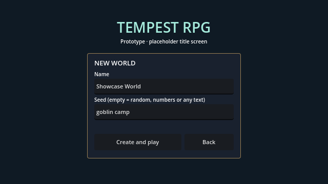
*New World: name and seed (numbers or any text, empty = random)* (640x360)

Automated, visible run on Windows. Viewport (640.0, 360.0), window (1280, 720). Movement, combat, absorb, skills and menus use the real input actions; menu buttons are pressed programmatically.

## 1. Spawn
- [x] Base resolution is 640x360

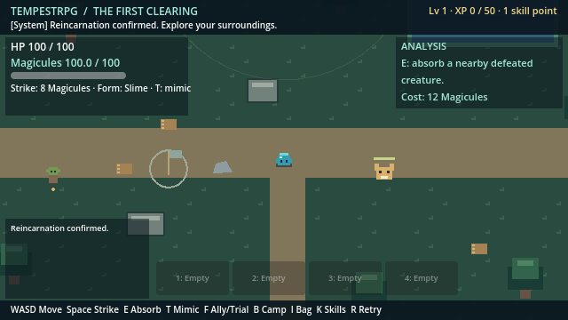
*Spawn: HUD, controls bar, hotbar and event log at 640x360* (640x360)

## 2. First fight

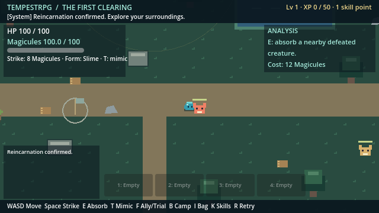
*Fighting: strike arc and enemy health bar* (640x360)

- [x] Defeated the first Forest Gnasher with real strikes

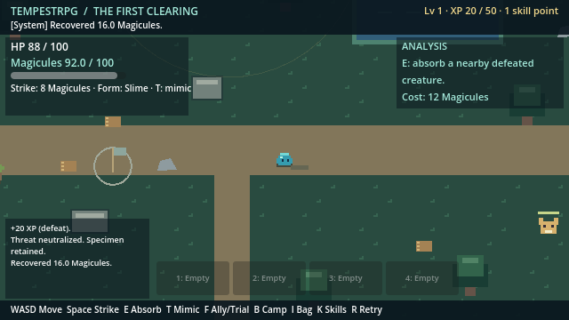
*Gnasher defeated; Magicule drop beside the corpse* (640x360)

## 3. Absorb and analyze

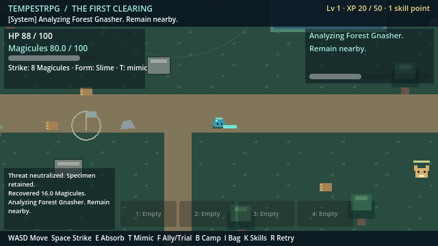
*Absorbing gnasher_1: analysis channel and progress bar* (640x360)

- [x] Absorbed the corpse
- [x] Rending Bite learned, waiting for activation

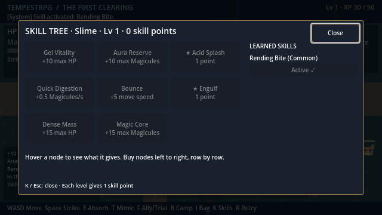
*Skill tree (K): the Slime tree on the left, learned skills on the right; Rending Bite activated with the level-1 point* (640x360)

- [x] Activated Rending Bite in the skill tree (K)
- [x] Activated Rending Bite sits in hotbar slot 1
- [x] Defeat dropped a Magicule pickup (collected on the spot when standing next to it)

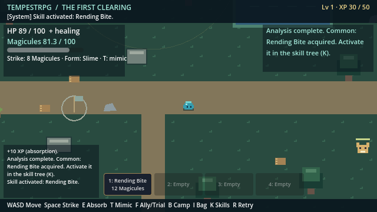
*Hotbar shows Rending Bite with cost* (640x360)

- [x] I opens the bag and pauses offline play

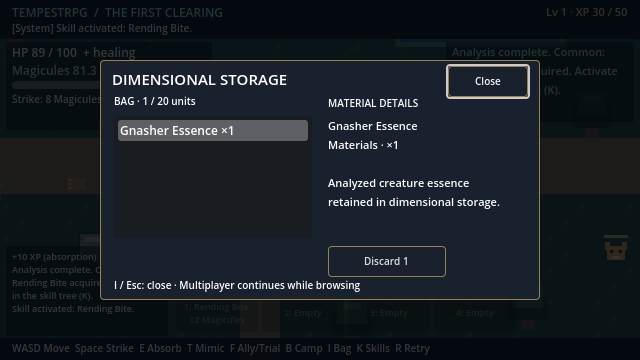
*Dimensional storage with Gnasher Essence* (640x360)

- [x] I closes the bag
## 4. Recruit and name the goblin
- [x] Walked west to the goblin
- [x] F opens the ally dialog

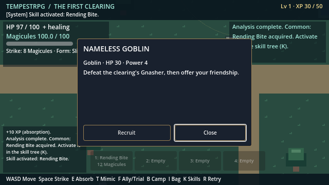
*Ally dialog before recruitment* (640x360)

- [x] Recruited the goblin

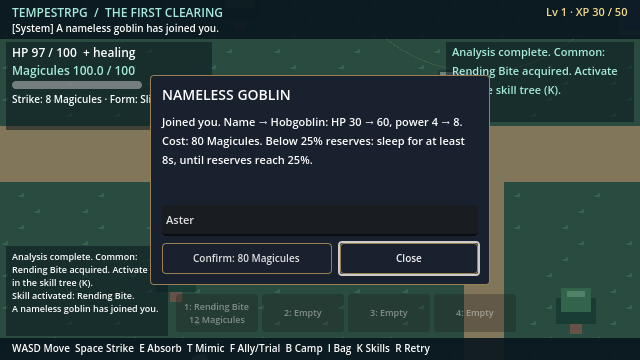
*Naming dialog: cost preview and name field* (640x360)

- [x] Named the ally Aster; evolved to Hobgoblin

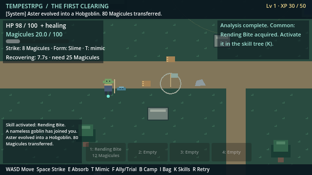
*Namer asleep below 25% Magicules; recovery timer; evolved Hobgoblin* (640x360)

- [x] Recovered from naming exhaustion
## 5. Found the camp and put the ally to work
- [x] Walked to the camp flag

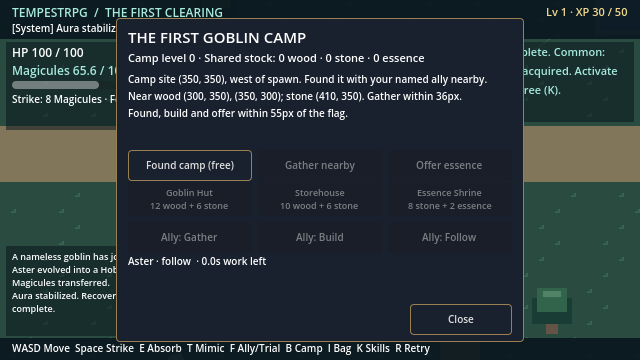
*Camp menu before founding* (640x360)

- [x] Founded the camp
- [x] Assigned the ally to gather

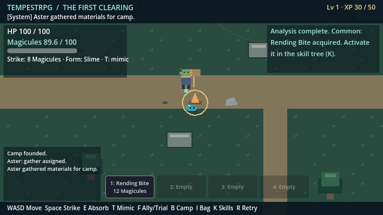
*Ally walking between near deposits* (640x360)

- [x] Ally gathered all near deposits (16 wood, 8 stone)
- [x] Assigned the ally to build
- [x] Ally built the Goblin Hut

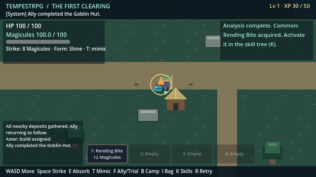
*Goblin Hut built; camp level 2* (640x360)

## 6. Explore for outlying materials
- [x] Walked east to the outlying wood

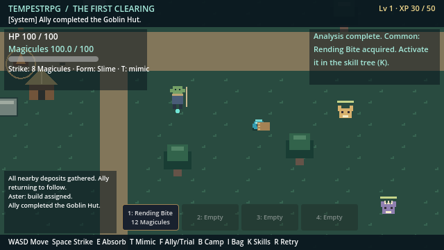
*Outlying wood near the second Gnasher* (640x360)

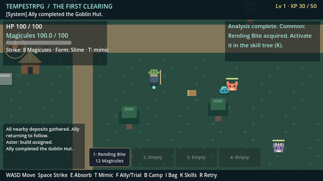
*Fighting: strike arc and enemy health bar* (640x360)

- [x] Defeated the second Gnasher using Rending Bite

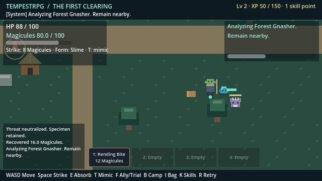
*Absorbing gnasher_2: analysis channel and progress bar* (640x360)

- [x] Absorbed the second Gnasher (second essence)
- [x] Returned to the wood pile
- [x] Gathered outlying wood
- [x] Walked northeast past the pond to outlying stone
- [x] Gathered northeast stone

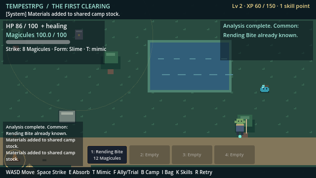
*Northeast stone deposit gathered* (640x360)

- [x] Walked to the southwest stone
- [x] Gathered southwest stone

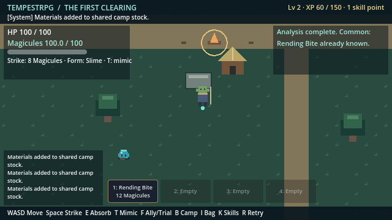
*Southwest stone deposit gathered* (640x360)

## 7. Grow the camp
- [x] Returned to camp

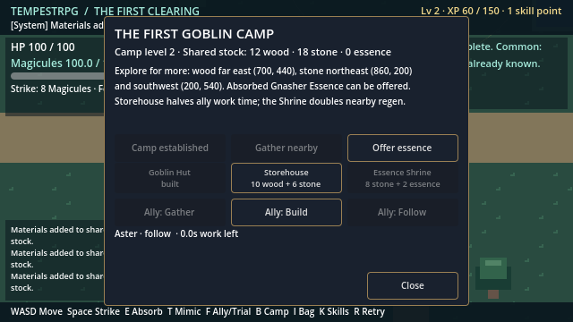
*Camp menu with outlying materials and essence in the bag* (640x360)

- [x] Offered two Gnasher Essences
- [x] Built the Storehouse
- [x] Built the Essence Shrine
- [x] Camp reached level 4

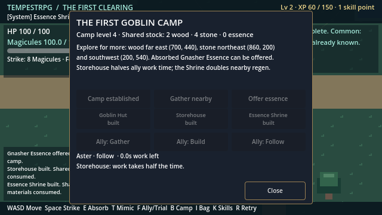
*Camp menu after all buildings: level 4* (640x360)

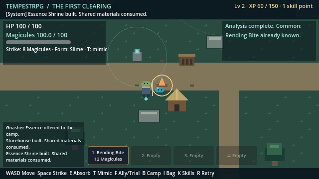
*Camp with hut, storehouse, shrine and range ring* (640x360)

## 8. Shrine
- [x] Walked to the shrine
  Magicules near shrine: 70.0 -> 95.1 in 3s (base regen 6/s after 1.5s delay)
- [x] Shrine visibly speeds up regeneration

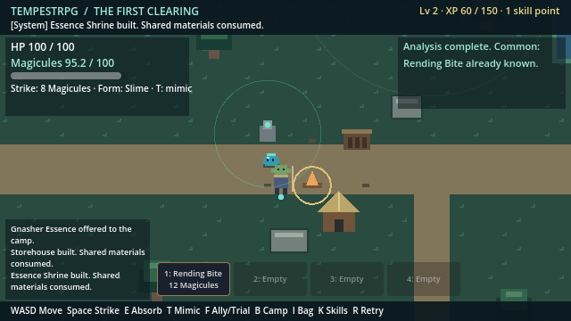
*Resting at the Essence Shrine* (640x360)

## 9. Thornback Gnasher and the first Extra skill
- [x] Walked to the southeast corner

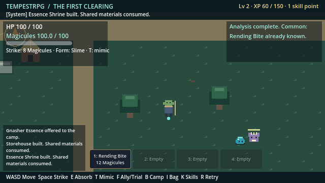
*Thornback Gnasher: spiny purple variant in the southeast corner* (640x360)

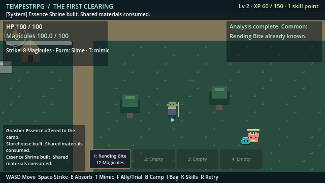
*Fighting: strike arc and enemy health bar* (640x360)

- [x] Defeated the Thornback Gnasher with Rending Bite

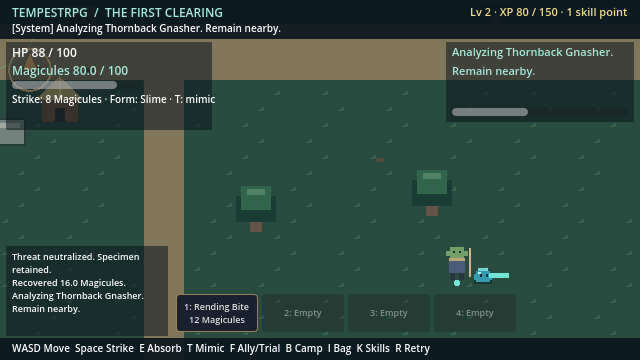
*Absorbing thornback_1: analysis channel and progress bar* (640x360)

- [x] Absorbed the Thornback
- [x] Learned Thorn Lash (Common) and Piercing Fang (Extra)
- [x] System Voice announced the Extra skill
- (XP assistance: +60 XP to reach level 3 for a skill point)
- [x] Activated Thorn Lash and Piercing Fang in the skill tree

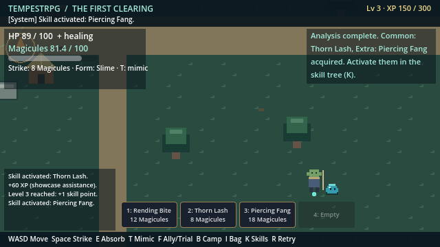
*Hotbar: Rending Bite, Thorn Lash and Piercing Fang* (640x360)

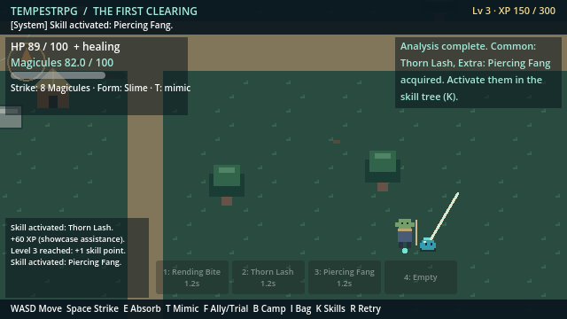
*Piercing Fang: long thrust that hits every creature in a line* (640x360)

- [x] Piercing Fang activated from hotbar slot 3
## 10. Mimicry: Gnasher Form
- [x] T transforms into Gnasher Form
- [x] Transformation cost 20 Magicules

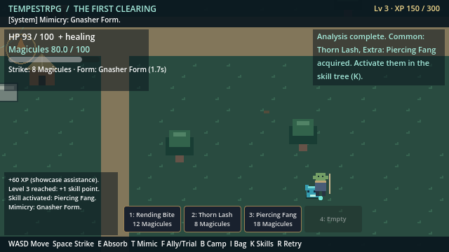
*Gnasher Form: cyan mimic of the Gnasher, faster, stronger basic strike; HUD shows form and cooldown* (640x360)

- [x] T returns to the slime after the cooldown
## 11. Proving Trial (placeholder) and the first Unique skill
- [x] Walked north to the trial stone
  Entering the trial with HP 100 / 100 (unassisted).
- [x] F at the stone starts the Proving Trial
- [x] Three trial creatures appear

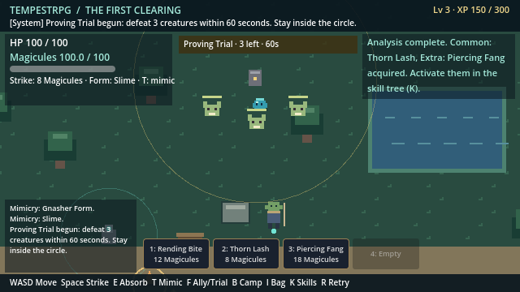
*Proving Trial: arena circle, three creatures and the trial banner* (640x360)

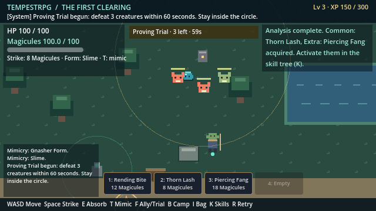
*Fighting: strike arc and enemy health bar* (640x360)

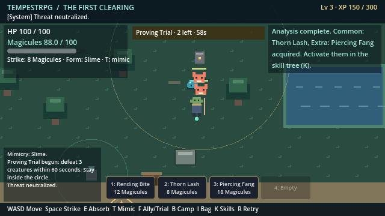
*Fighting: strike arc and enemy health bar* (640x360)

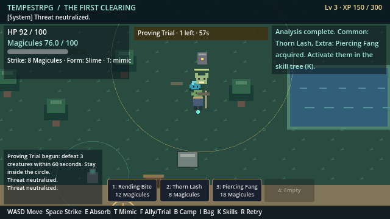
*Fighting: strike arc and enemy health bar* (640x360)

- [x] Trial ends after the last creature falls
- [x] Trial complete: Predator Focus (Unique) learned
- [x] System Voice announced the Unique skill
- (XP assistance: +90 XP to reach level 4 for a skill point)
- [x] Activated Predator Focus in the skill tree
- [x] Slot 4 arms Predator Focus

*Unique skill: Predator Focus armed from hotbar slot 4* (640x360)

## 11b. Experience and levels
- [x] Reached level 4 (300 XP, 0 skill points) from defeats, absorptions and the trial
- [x] HUD title bar shows the level: Lv 4 · XP 300 / 500
- [x] The System Voice announced a level-up

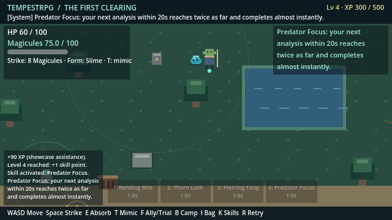
*Level, XP and unspent skill points in the top-right of the HUD* (640x360)

- (XP assistance: +200 XP to reach level 5 for a skill point)

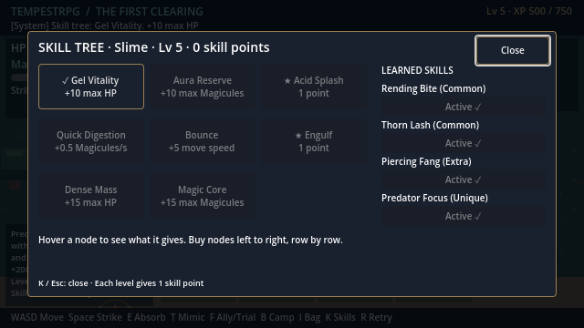
*Skill tree: Gel Vitality bought (+10 max HP)* (640x360)

- [x] Bought a stat node: Gel Vitality +10 max HP
## 12. Pause menu and Open to friends
- [x] World is hosted solo and saved, no port open
- [x] Esc opens the pause menu and freezes the solo world

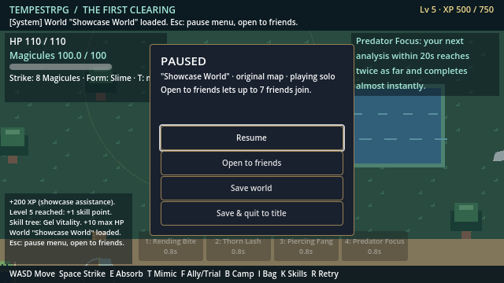
*Pause menu while playing solo: Resume, Open to friends, Save, Save & quit* (640x360)

- [x] Open to friends starts listening without a restart

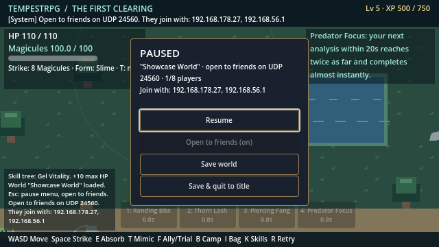
*Pause menu after Open to friends: port and LAN address for friends* (640x360)

- [x] Esc resumes
## 13. Seeded worlds

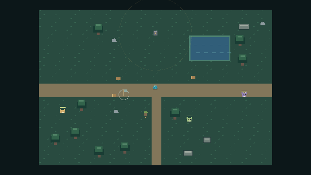
*Seed "goblin camp" (761927873): deposits, creatures, trial stone, ally, 9 trees and 3 rocks placed from the seed* (640x360)

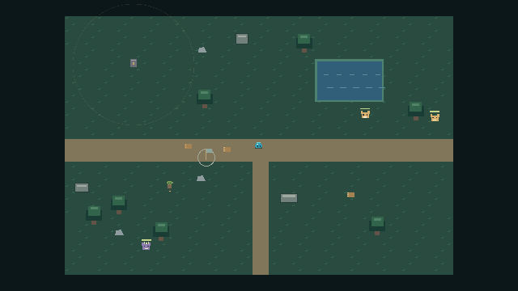
*Seed "tempest" (1487913639): deposits, creatures, trial stone, ally, 7 trees and 3 rocks placed from the seed* (640x360)

- [x] Different seeds lay out different worlds; the same seed repeats exactly
## 14. Playable races
- [x] Human and Demon are created with their own stats

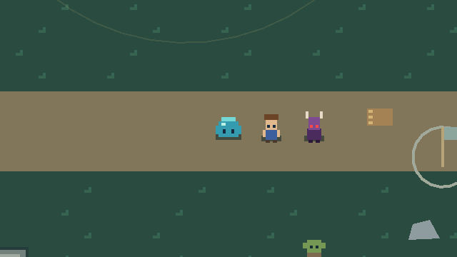
*Playable races, left to right: Slime, Human, Demon (placeholder looks)* (640x360)

## System messages seen

- +20 XP (defeat).
- Threat neutralized. Specimen retained.
- Recovered 16.0 Magicules.
- Analyzing Forest Gnasher. Remain nearby.
- Absorbed vitality: +25 HP over 10s.
- +10 XP (absorption).
- Analysis complete. Common: Rending Bite acquired. Activate it in the skill tree (K).
- Skill activated: Rending Bite.
- A nameless goblin has joined you.
- Aster evolved into a Hobgoblin. 80 Magicules transferred.
- Aura stabilized. Recovery complete.
- Camp founded.
- Aster: gather assigned.
- Aster gathered materials for camp.
- Aster gathered materials for camp.
- Aster gathered materials for camp.
- All nearby deposits gathered. Ally returning to follow.
- Aster: build assigned.
- Ally completed the Goblin Hut.
- +20 XP (defeat). Level 2 reached: +1 skill point.
- Threat neutralized. Specimen retained.
- Recovered 16.0 Magicules.
- Analyzing Forest Gnasher. Remain nearby.
- Absorbed vitality: +25 HP over 10s.
- +10 XP (absorption).
- Analysis complete. Common: Rending Bite already known.
- Materials added to shared camp stock.
- Materials added to shared camp stock.
- Materials added to shared camp stock.
- Gnasher Essence offered to the camp.
- Gnasher Essence offered to the camp.
- Storehouse built. Shared materials consumed.
- Essence Shrine built. Shared materials consumed.
- +20 XP (defeat).
- Threat neutralized. Specimen retained.
- Recovered 16.0 Magicules.
- Analyzing Thornback Gnasher. Remain nearby.
- Absorbed vitality: +25 HP over 10s.
- +10 XP (absorption).
- Analysis complete. Common: Thorn Lash, Extra: Piercing Fang acquired. Activate them in the skill tree (K).
- Skill activated: Thorn Lash.
- +60 XP (showcase assistance). Level 3 reached: +1 skill point.
- Skill activated: Piercing Fang.
- Mimicry: Gnasher Form.
- Mimicry: Slime.
- Proving Trial begun: defeat 3 creatures within 60 seconds. Stay inside the circle.
- Threat neutralized.
- Threat neutralized.
- Threat neutralized.
- Proving Trial complete. Unique: Predator Focus acquired. Activate it in the skill tree (K).
- +60 XP (trial).
- +90 XP (showcase assistance). Level 4 reached: +1 skill point.
- Skill activated: Predator Focus.
- Predator Focus: your next analysis within 20s reaches twice as far and completes almost instantly.
- +200 XP (showcase assistance). Level 5 reached: +1 skill point.
- Skill tree: Gel Vitality. +10 max HP
- World "Showcase World" loaded. Esc: pause menu, open to friends.
- Open to friends on UDP 24560. They join with: 192.168.178.27, 192.168.56.1

The bot retreated 1 time(s) to let Magicules recover.
XP assistance for skill points: 350 XP in total (the slice has three creatures and no respawns yet).

**Result: 0 failed checks, 42 screenshots.**
