# Visual playtest — full first slice

Automated, visible run on Windows. Viewport (640.0, 360.0), window (1280, 720). Movement, combat, absorb, skills and menus use the real input actions; menu buttons are pressed programmatically.

## 1. Spawn
- [x] Base resolution is 640x360

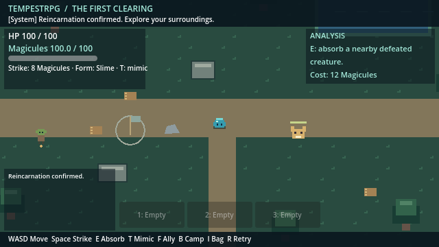
*Spawn: HUD, controls bar, hotbar and event log at 640x360* (640x360)

## 2. First fight

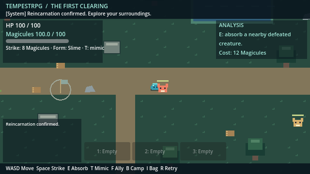
*Fighting: strike arc and enemy health bar* (640x360)

- [x] Defeated the first Forest Gnasher with real strikes

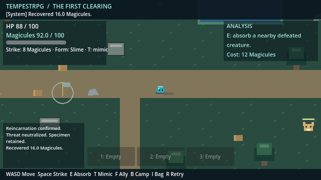
*Gnasher defeated; Magicule drop beside the corpse* (640x360)

## 3. Absorb and analyze

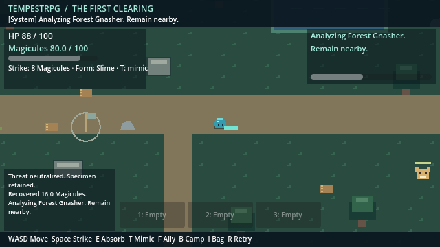
*Absorbing gnasher_1: analysis channel and progress bar* (640x360)

- [x] Absorbed the corpse
- [x] Learned Rending Bite into hotbar slot 1
- [x] Defeat dropped a Magicule pickup (collected on the spot when standing next to it)

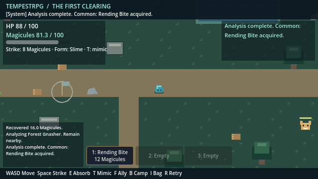
*Hotbar shows Rending Bite with cost* (640x360)

- [x] I opens the bag and pauses offline play

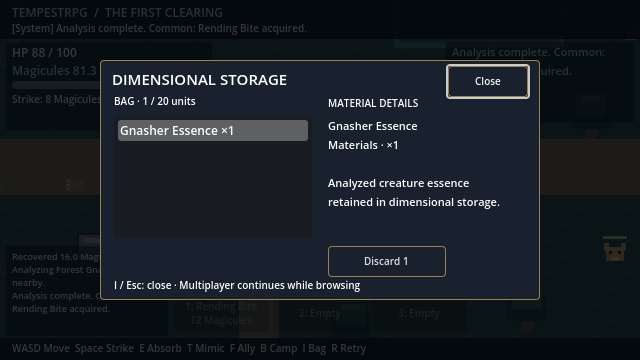
*Dimensional storage with Gnasher Essence* (640x360)

- [x] I closes the bag
## 4. Recruit and name the goblin
- [x] Walked west to the goblin
- [x] F opens the ally dialog

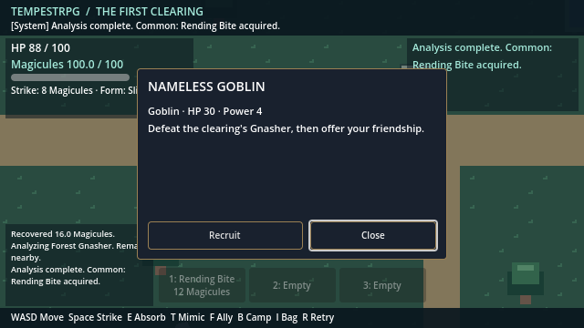
*Ally dialog before recruitment* (640x360)

- [x] Recruited the goblin

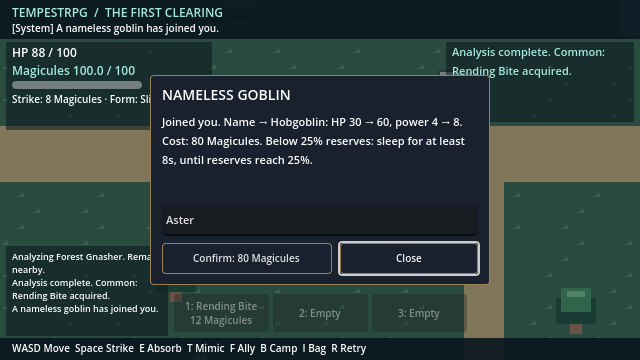
*Naming dialog: cost preview and name field* (640x360)

- [x] Named the ally Aster; evolved to Hobgoblin

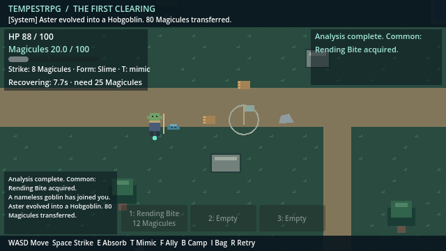
*Namer asleep below 25% Magicules; recovery timer; evolved Hobgoblin* (640x360)

- [x] Recovered from naming exhaustion
## 5. Found the camp and put the ally to work
- [x] Walked to the camp flag

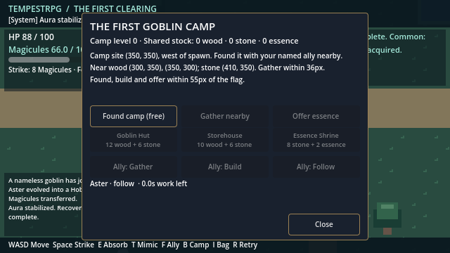
*Camp menu before founding* (640x360)

- [x] Founded the camp
- [x] Assigned the ally to gather

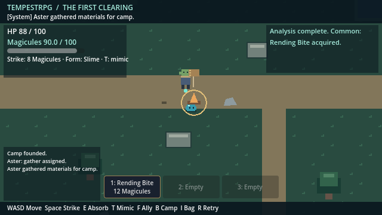
*Ally walking between near deposits* (640x360)

- [x] Ally gathered all near deposits (16 wood, 8 stone)
- [x] Assigned the ally to build
- [x] Ally built the Goblin Hut

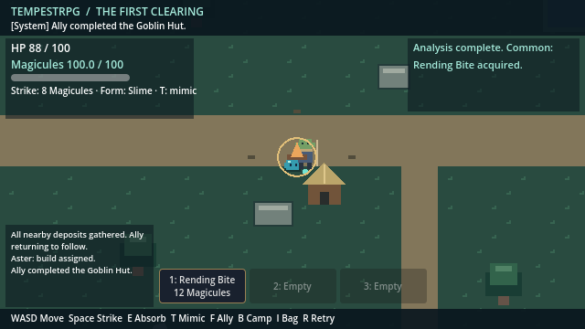
*Goblin Hut built; camp level 2* (640x360)

## 6. Explore for outlying materials
- [x] Walked east to the outlying wood

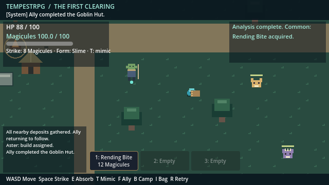
*Outlying wood near the second Gnasher* (640x360)

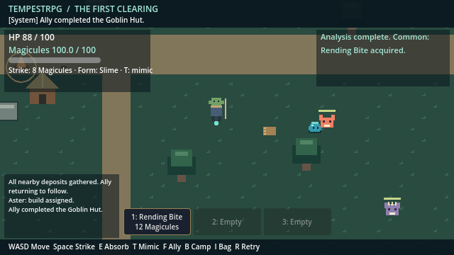
*Fighting: strike arc and enemy health bar* (640x360)

- [x] Defeated the second Gnasher using Rending Bite

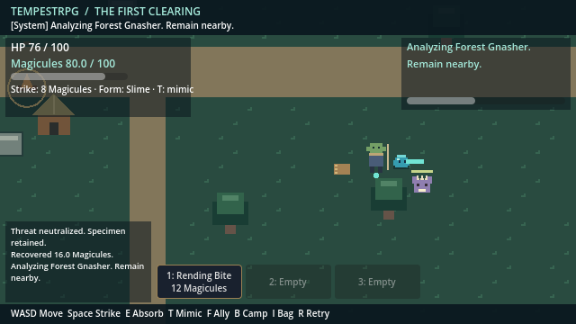
*Absorbing gnasher_2: analysis channel and progress bar* (640x360)

- [x] Absorbed the second Gnasher (second essence)
- [x] Returned to the wood pile
- [x] Gathered outlying wood
- [x] Walked northeast past the pond to outlying stone
- [x] Gathered northeast stone

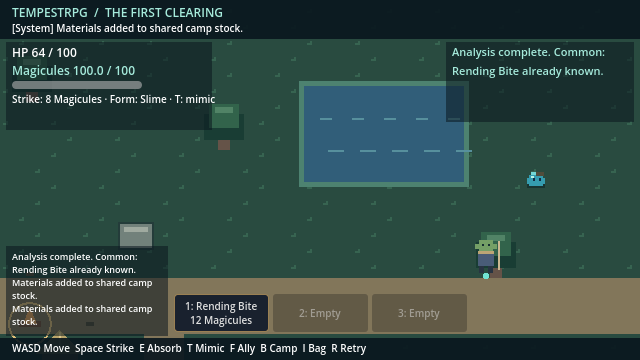
*Northeast stone deposit gathered* (640x360)

- [x] Walked to the southwest stone
- [x] Gathered southwest stone

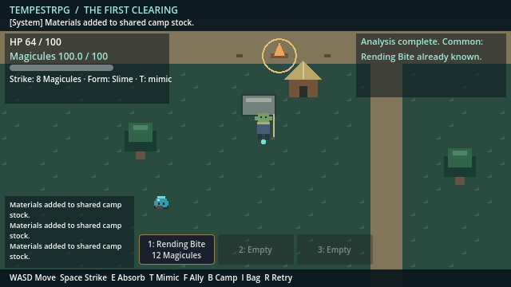
*Southwest stone deposit gathered* (640x360)

## 7. Grow the camp
- [x] Returned to camp

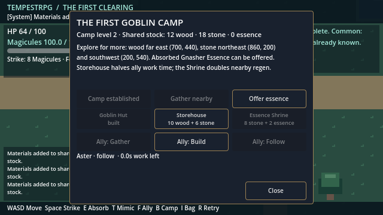
*Camp menu with outlying materials and essence in the bag* (640x360)

- [x] Offered two Gnasher Essences
- [x] Built the Storehouse
- [x] Built the Essence Shrine
- [x] Camp reached level 4

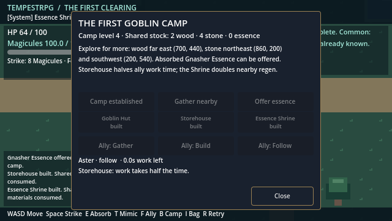
*Camp menu after all buildings: level 4* (640x360)

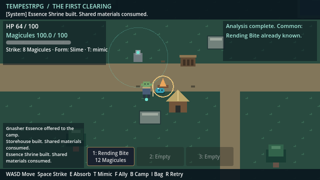
*Camp with hut, storehouse, shrine and range ring* (640x360)

## 8. Shrine
- [x] Walked to the shrine
  Magicules near shrine: 70.0 -> 94.9 in 3s (base regen 6/s after 1.5s delay)
- [x] Shrine visibly speeds up regeneration

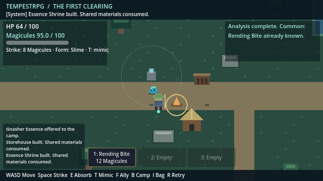
*Resting at the Essence Shrine* (640x360)

## 9. Thornback Gnasher and the first Extra skill
- [x] Walked to the southeast corner

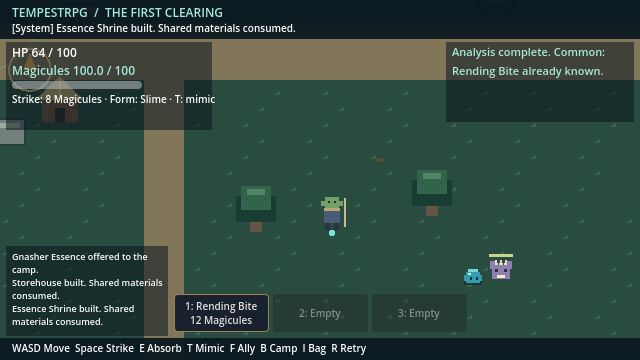
*Thornback Gnasher: spiny purple variant in the southeast corner* (640x360)

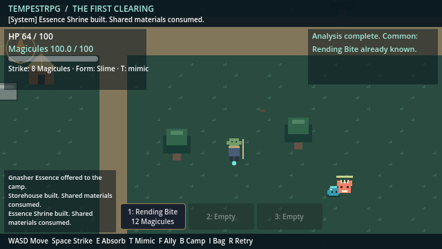
*Fighting: strike arc and enemy health bar* (640x360)

- [x] Defeated the Thornback Gnasher with Rending Bite

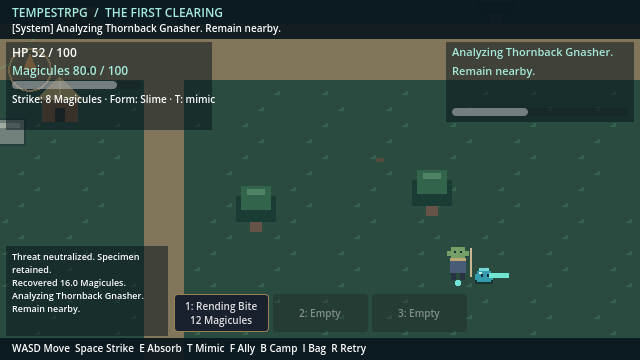
*Absorbing thornback_1: analysis channel and progress bar* (640x360)

- [x] Absorbed the Thornback
- [x] Learned Thorn Lash (Common) and Piercing Fang (Extra)
- [x] System Voice announced the Extra skill

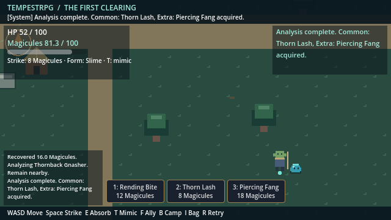
*Hotbar: Rending Bite, Thorn Lash and Piercing Fang* (640x360)

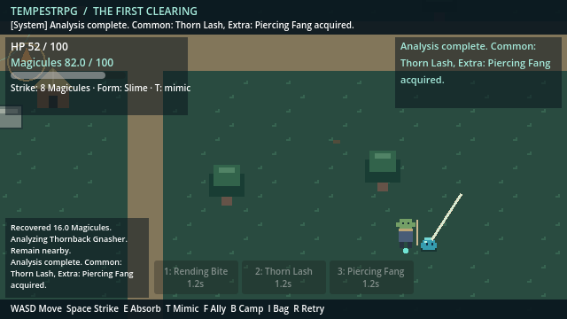
*Piercing Fang: long thrust that hits every creature in a line* (640x360)

- [x] Piercing Fang activated from hotbar slot 3
## 10. Mimicry: Gnasher Form
- [x] T transforms into Gnasher Form
- [x] Transformation cost 20 Magicules

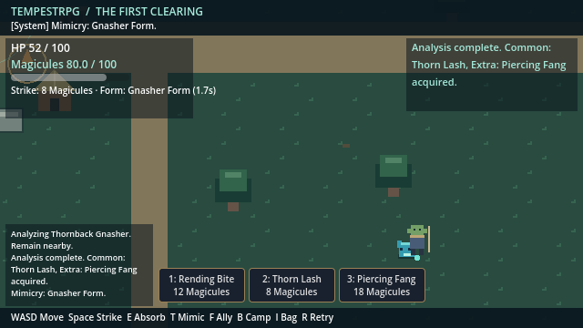
*Gnasher Form: cyan mimic of the Gnasher, faster, stronger basic strike; HUD shows form and cooldown* (640x360)

- [x] T returns to the slime after the cooldown
## 11. Multiplayer panel

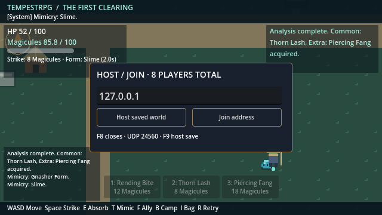
*F8 host/join panel* (640x360)

## System messages seen

- Threat neutralized. Specimen retained.
- Recovered 16.0 Magicules.
- Analyzing Forest Gnasher. Remain nearby.
- Analysis complete. Common: Rending Bite acquired.
- A nameless goblin has joined you.
- Aster evolved into a Hobgoblin. 80 Magicules transferred.
- Aura stabilized. Recovery complete.
- Camp founded.
- Aster: gather assigned.
- Aster gathered materials for camp.
- Aster gathered materials for camp.
- Aster gathered materials for camp.
- All nearby deposits gathered. Ally returning to follow.
- Aster: build assigned.
- Ally completed the Goblin Hut.
- Threat neutralized. Specimen retained.
- Recovered 16.0 Magicules.
- Analyzing Forest Gnasher. Remain nearby.
- Analysis complete. Common: Rending Bite already known.
- Materials added to shared camp stock.
- Materials added to shared camp stock.
- Materials added to shared camp stock.
- Gnasher Essence offered to the camp.
- Gnasher Essence offered to the camp.
- Storehouse built. Shared materials consumed.
- Essence Shrine built. Shared materials consumed.
- Threat neutralized. Specimen retained.
- Recovered 16.0 Magicules.
- Analyzing Thornback Gnasher. Remain nearby.
- Analysis complete. Common: Thorn Lash, Extra: Piercing Fang acquired.
- Mimicry: Gnasher Form.
- Mimicry: Slime.

**Result: 0 failed checks, 28 screenshots.**
